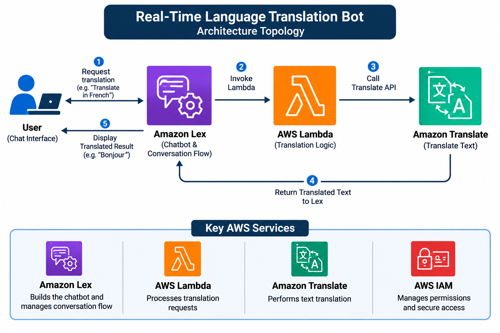
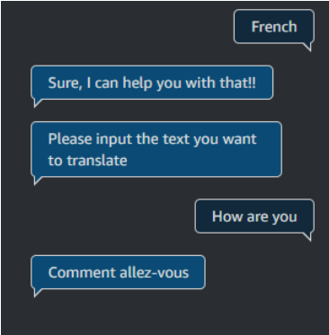
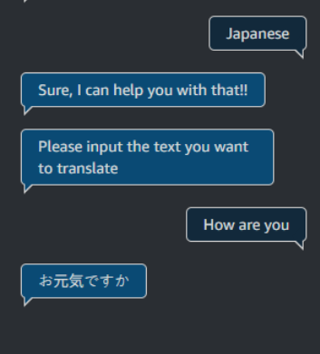
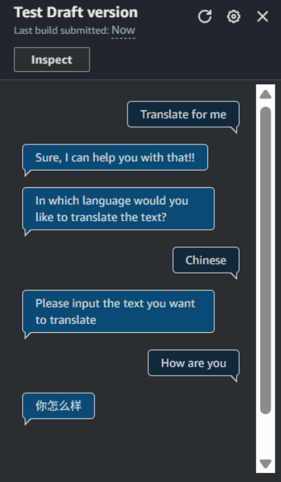
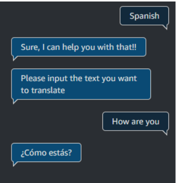

# 🌐 Real-Time Language Translation Bot

A serverless, conversational language translation chatbot built using **Amazon Lex, AWS Lambda, and Amazon Translate**. Users can interact with the chatbot, select a target language, and receive translated text through a simple conversational interface.

## 📌 Project Overview

This project demonstrates how multiple AWS services can be integrated to develop an automated language translation solution using a serverless architecture.

Users interact with an Amazon Lex chatbot by specifying their preferred target language and entering the text they want to translate. AWS Lambda processes the request and invokes Amazon Translate to perform the translation automatically.

The translated result is then returned to the user through Amazon Lex.

### ✨ Project Highlights

- Conversational chatbot interface powered by Amazon Lex.
- Automated text translation using Amazon Translate.
- Serverless processing through AWS Lambda.
- Automatic source language detection.
- Support for multiple target languages.
- Secure service integration using AWS IAM.

## ☁️ AWS Services Used

| AWS Service | Purpose |
|---|---|
| **Amazon Lex** | Builds the chatbot and manages conversation flow, intents, and slots. |
| **AWS Lambda** | Processes translation requests and invokes Amazon Translate. |
| **Amazon Translate** | Performs automatic text translation. |
| **AWS IAM** | Manages permissions and secure access between AWS services. |

## 🏗️ Architecture

The application follows a serverless architecture where Amazon Lex handles user interactions, AWS Lambda processes translation requests, and Amazon Translate performs the actual translation.



### Process Workflow

1. **User Request:** User interacts with the Amazon Lex chatbot and requests a translation.
2. **Intent Recognition:** Amazon Lex identifies the request through `TranslationIntent`.
3. **Input Collection:** The chatbot collects the target language and text to translate.
4. **Lambda Invocation:** Amazon Lex invokes the associated AWS Lambda function.
5. **Request Processing:** Lambda extracts the user's input and target language.
6. **Translation Request:** Lambda calls the Amazon Translate API.
7. **Text Translation:** Amazon Translate detects the source language and translates the text.
8. **Response Handling:** Lambda returns the translated result to Amazon Lex.
9. **User Response:** Amazon Lex displays the translated text to the user.

## 🌍 Supported Languages

The chatbot currently supports the following target languages:

| Language | Language Code |
|---|---|
| French | `fr` |
| Japanese | `ja` |
| Chinese | `zh` |
| Spanish | `es` |
| German | `de` |
| Norwegian | `no` |

Amazon Translate automatically detects the source language using the `auto` source language setting.

## 🖥️ Translation Results

Below are screenshots demonstrating successful translation requests using different target languages.

### 🇫🇷 French Translation



### 🇯🇵 Japanese Translation



### 🇨🇳 Chinese Translation



### 🇪🇸 Spanish Translation



## ⚙️ Implementation Steps

### 1. Create an Amazon Lex Bot

1. Navigate to Amazon Lex in the AWS Management Console.
2. Select **Create Bot**.
3. Choose the Traditional creation method.
4. Create a blank bot without preconfigured languages, intents, or slot types.
5. Configure the bot:
   - Bot Name: `TextTranslatorBryan`
   - Runtime Role: Create a role with basic Amazon Lex permissions.
   - COPPA: No
   - Bot Error Logging: Disabled
6. Add English (US) as the primary language.

**Note:** Amazon Lex is not available in every AWS Region. Select a supported Region, such as Asia Pacific (Singapore), before creating the bot.

### 2. Configure the Translation Intent

Create a new intent named:

`TranslationIntent`

Add the following sample utterances:

- I want to translate
- Can you help me translate
- Translate for me
- I want to translate in {language}
- Translate in {language}
- Can you translate in {language} for me

### 3. Configure Slot Types and Slots

Create a custom slot type named `language` and add the following values:

- French
- Japanese
- Chinese
- Spanish
- German
- Norwegian

Add the following slots to `TranslationIntent`:

| Slot Name | Slot Type | Prompt |
|---|---|---|
| `language` | Custom Slot Type: `language` | In which language would you like to translate the text? |
| `text` | `AMAZON.FreeFormInput` | Please input the text you want to translate. |

Configure the initial response:

> Sure, I can help you with that!

Configure the fulfilment responses:

- Successful fulfilment: Your request was completed successfully.
- Failed fulfilment: Something went wrong.

Enable **Use a Lambda function for fulfilment** under Advanced Options.

Configure the closing response:

> I hope the translation was helpful.

### 4. Create an IAM Role for Lambda

Navigate to AWS IAM and create a new role.

**Configuration:**

- Trusted Entity: AWS Service
- Use Case: Lambda

Attach the following permission policies:

- `TranslateFullAccess`
- `AWSLambdaBasicExecutionRole`

**Role Name:** `LambdaBotRole`

**Security Note:** For production environments, replace broad TranslateFullAccess permissions with a custom least-privilege IAM policy granting only the required Amazon Translate permissions.

### 5. Create the AWS Lambda Function

Navigate to AWS Lambda and create a function.

**Configuration:**

- Creation Method: Author from Scratch
- Function Name: `TranslateBot`
- Runtime: Python
- Architecture: Default
- Execution Role: Use an existing role
- Existing Role: `LambdaBotRole`

Replace the default Lambda code with the Python implementation provided in the `docs` folder.

**Source Code:** [lambda_function.py](docs/lambda_function.py)

Select **Deploy** after adding the code.

### 6. Test the Lambda Function

Create a test event named:

`translationtest`

Use the test event JSON provided in:

[test-event.json](docs/test-event.json)

The test event contains sample input text and the target language required to simulate an Amazon Lex request.

Select **Test** to execute the Lambda function.

**Expected Output:**

`Bonjour`

### 7. Connect Lambda to Amazon Lex

Return to the Amazon Lex console.

1. Open the `TextTranslatorBryan` bot.
2. Navigate to the `TranslationIntent`.
3. Open the fulfilment settings.
4. Enable the Lambda function integration.
5. Select `TranslateBot` as the Lambda function.
6. Save the configuration.
7. Build the bot.

Ensure the Lambda function is associated with the correct bot alias and language configuration, and that Lex has permission to invoke it.

### 8. Test the Chatbot

Open the Amazon Lex testing console and test the chatbot using different languages.

**Example Conversation:**

**User:** I want to translate in French.

**Chatbot:** In which language would you like to translate the text?

**User:** French.

**Chatbot:** Please input the text you want to translate.

**User:** Hello.

**Chatbot:** Bonjour.

## 🧪 Testing Results

The chatbot successfully processes translation requests and returns translated text for different target languages.

| Input Text | Target Language | Expected Translation |
|---|---|---|
| Hello | French | Bonjour |
| Hello | Japanese | こんにちは |
| Hello | Chinese | 你好 |
| Hello | Spanish | Hola |

## 📚 Key Learning Outcomes

Through this project, I gained practical experience in:

- Building conversational chatbots using Amazon Lex.
- Configuring intents, sample utterances, custom slot types, and slot prompts.
- Integrating AWS Lambda with Amazon Lex fulfilment.
- Using Amazon Translate API through the AWS SDK for Python (Boto3).
- Implementing automatic source language detection.
- Configuring IAM roles and permissions for AWS service integration.
- Developing serverless applications using managed AWS services.

## 📁 Repository Structure

```text
aws-real-time-language-translation-bot/
│
├── README.md
│
├── docs/
│   ├── lambda_function.py
│   └── test-event.json
│
└── images/
    ├── Language-Translate-Bot-Topology.png
    ├── french-translation.png
    ├── japanese-translation.png
    ├── chinese-translation.png
    └── spanish-translation.png
```

## 📝 Project Summary

This project demonstrates how multiple AWS services can work together to build an automated, conversational language translation solution without managing traditional servers.

By combining Amazon Lex, AWS Lambda, and Amazon Translate, users can translate text through a simple chatbot interface.

**Architecture:** Amazon Lex → AWS Lambda → Amazon Translate → AWS Lambda → Amazon Lex

---

*Built as part of my hands-on AWS cloud and serverless application development portfolio.*
